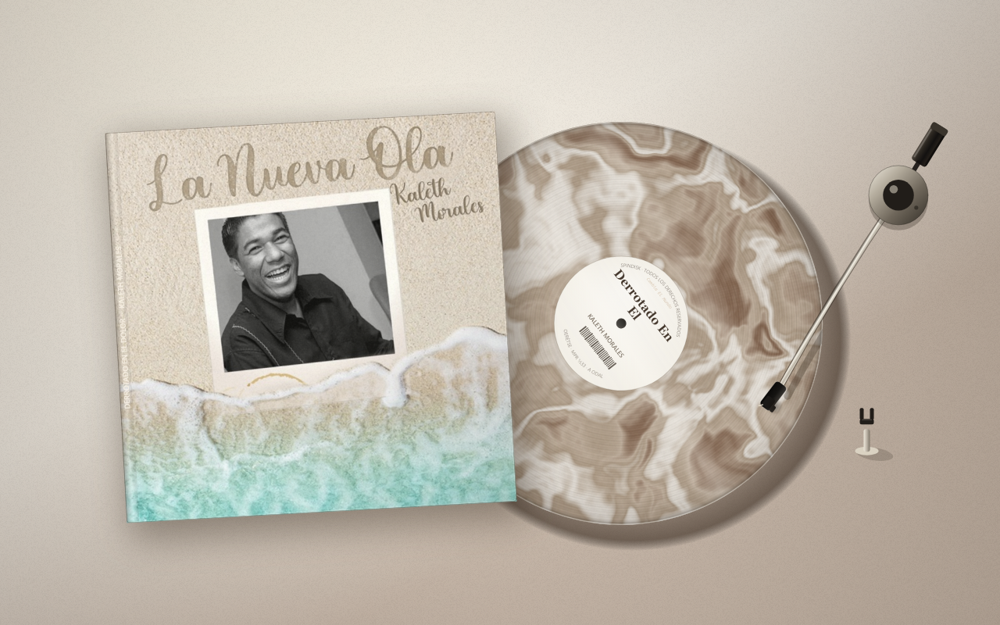
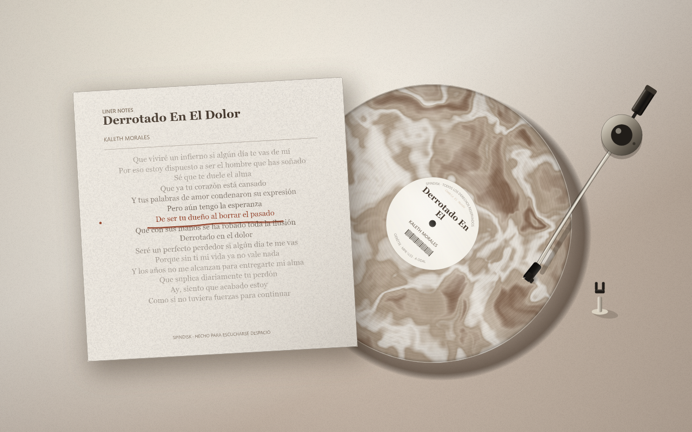
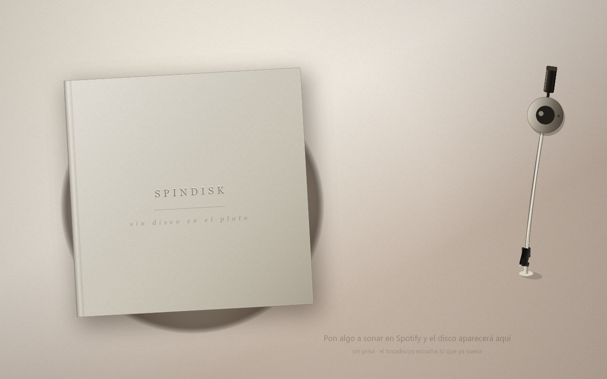
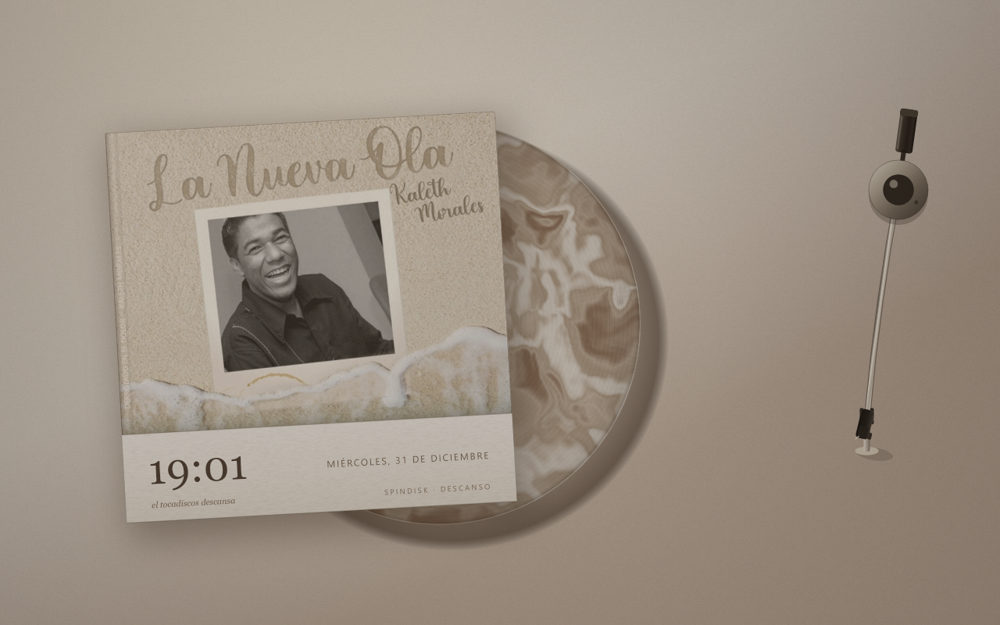
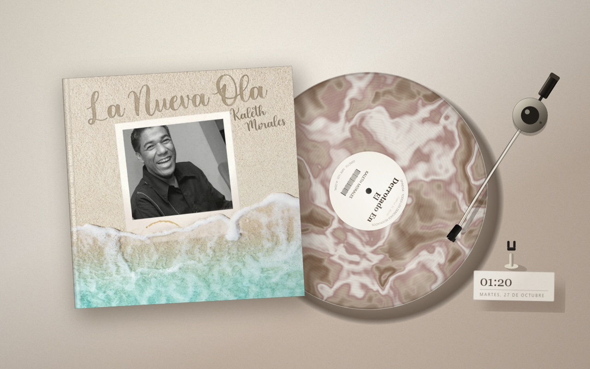
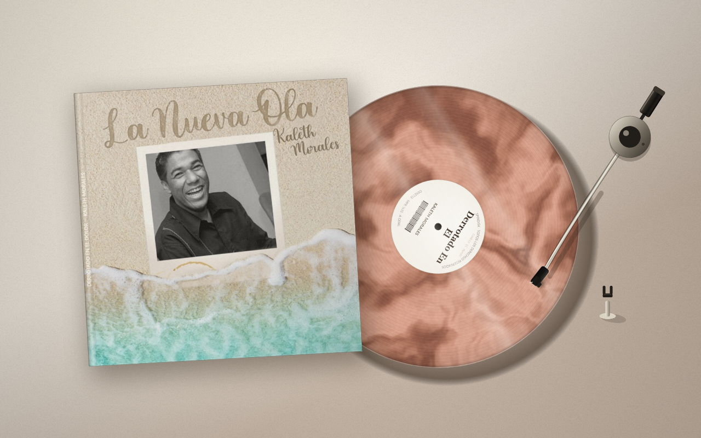
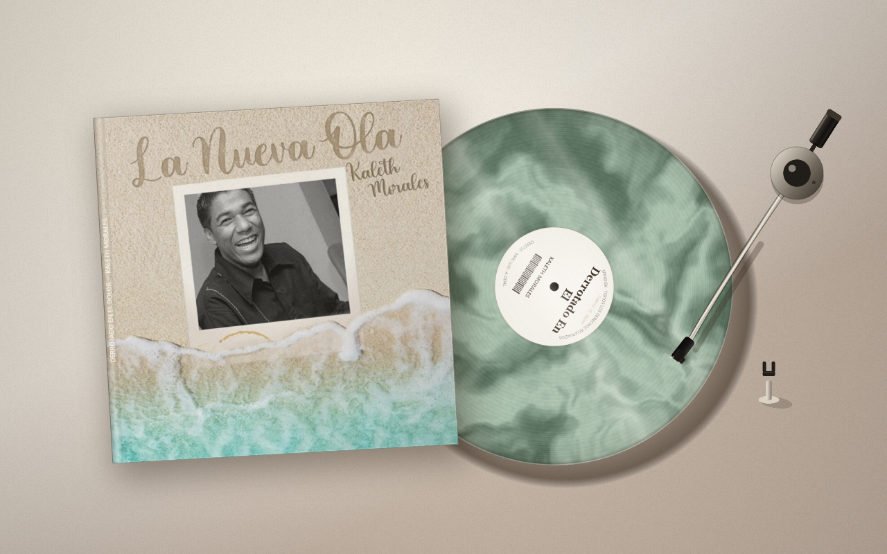
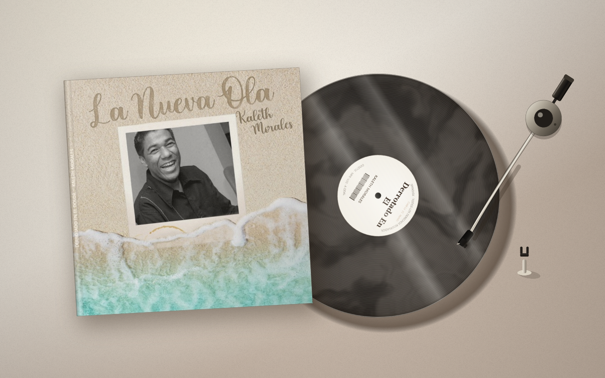
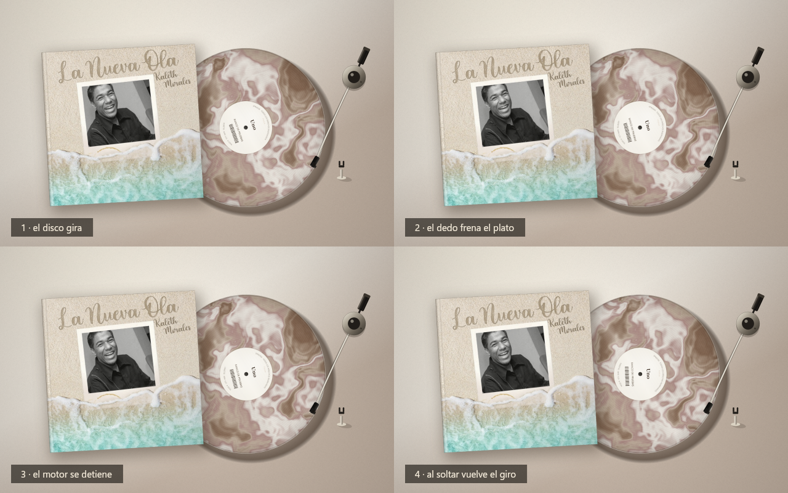
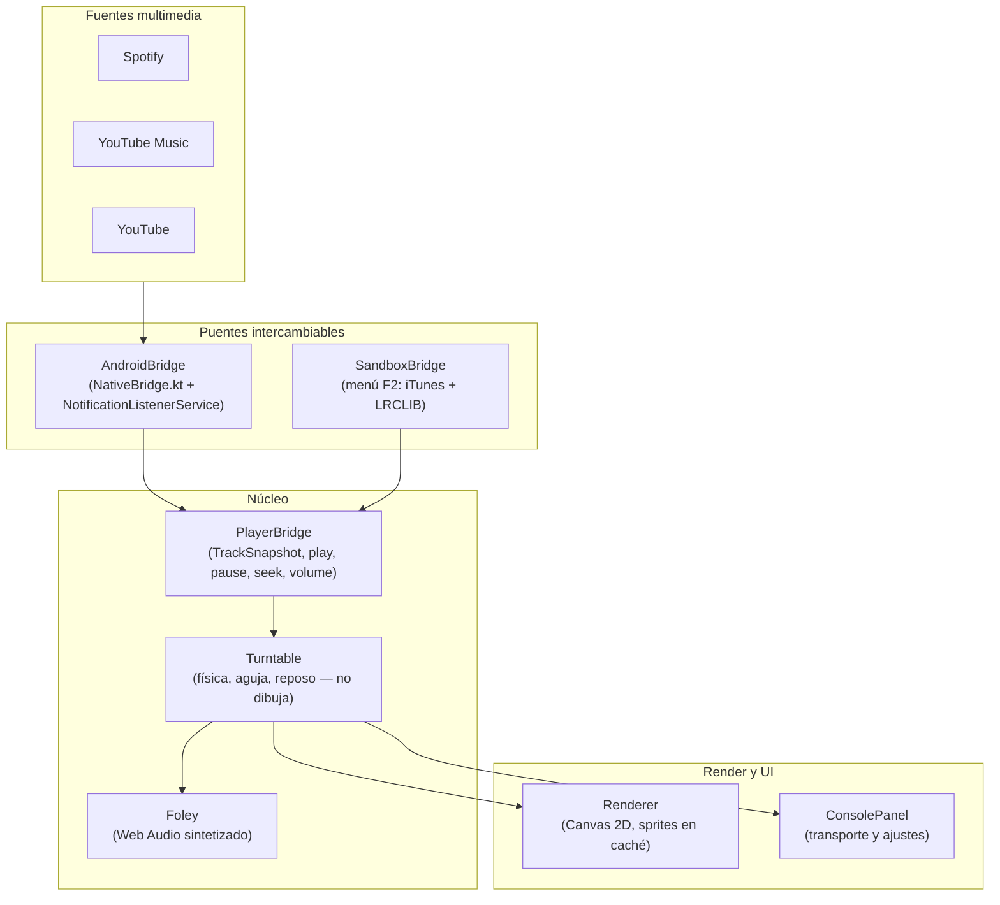

# SpinDisk · Tocadiscos de escritorio

[](https://github.com/Ynnoil1211/SpinDisk/actions/workflows/build-apk.yml)


-3ddc84?logo=android&logoColor=white)


**Convierte lo que ya suena en Spotify, YouTube Music o YouTube en un tocadiscos físico y táctil para tablets Android en horizontal.** SpinDisk no reproduce audio: se engancha a la sesión multimedia del sistema y la representa como un vinilo que gira, una aguja que puedes arrastrar, una funda con letras sincronizadas y un reloj de reposo que dibuja un solo frame por minuto.

<p align="center">
  
  
</p>

<details>
<summary>📸 Más capturas (texturas, reloj, freno)</summary>

| Mesa vacía | Modo reloj | Reloj de día |
| :---: | :---: | :---: |
|  |  |  |
| **Terracota** | **Verde salvia** | **Humo ámbar** |
|  |  |  |

Tira de la simulación de freno con el dedo:



</details>

---

## ✨ Características principales

- **Física de tocadiscos real:** inercia al arrancar y frenar (33⅓ y 45 RPM), freno con el dedo sobre el vinilo (pausa/reanuda) y arrastre del brazo para hacer *seek* en Spotify Premium y YouTube.
- **Modo protegido para Spotify Free:** cuando la sesión no permite *seek*, la aguja vibra, rebota elásticamente a su sitio y sólo llevarla al centro salta de pista.
- **Funda interactiva (*liner notes*):** toca la carátula para voltearla en 3D; el reverso muestra letras sincronizadas verso a verso vía [LRCLIB](https://lrclib.net/) o una ficha técnica si la canción es instrumental.
- **Sonido Foley 100 % sintetizado:** chisporroteo de surco, caída de aguja y chasquido del motor generados con Web Audio API — cero archivos de audio. El volumen se sincroniza con el del sistema.
- **7 texturas de vinilo y 5 fondos de mesa**, con un motor cromático *«Tierra y Pastel»* que extrae la paleta de la carátula en tiempo real.
- **Reposo de bajísimo consumo:** tras 60 s en pausa, el disco vuelve a la funda y aparece un reloj con fecha y frases aleatorias que se repinta **una vez por minuto**.
- **Consola ergonómica:** se abre desde el borde inferior, la esquina superior izquierda o tocando la mesa; se oculta sola a los 3 s o con *swipe down*.
- **Stack:** TypeScript + Canvas 2D (web), Kotlin + `WebView` + `NotificationListenerService` (Android), GitHub Actions (CI/APK). Sin bundler, sin Capacitor, sin WebGL.

---

## 🏗️ Arquitectura

El motor visual **no sabe de dónde viene la música**: todo entra por un único contrato (`TrackSnapshot` + `PlayerBridge`). En el navegador lo alimenta un simulador; en la tablet, la `MediaSession` real. Cambiar de uno a otro no toca una línea de dibujo.



<details>
<summary>📂 Estructura del proyecto</summary>

```text
SpinDisk/
├── index.html                 # Lienzo y consola
├── src/
│   ├── main.ts                # Arranque, elección de puente, bucle adaptativo, gestos globales
│   ├── styles.css             # Consola translúcida, sandbox, avisos
│   ├── core/                  # Contrato (types.ts) y preferencias en localStorage (store.ts)
│   ├── bridge/                # android.ts (WebView ↔ Kotlin), sandbox.ts (simulador), lyrics.ts (LRCLIB)
│   ├── scene/                 # layout, turntable (física/estados), disc, sleeve, renderer
│   ├── render/canvas.ts       # Primitivas: sombras, grano, texto curvo, mármol fBm
│   ├── theme/                 # Paleta «Tierra y Pastel» y fuentes
│   ├── audio/foley.ts         # Estática, caída de aguja y motor (Web Audio)
│   ├── ui/                    # Consola, panel F2, avisos, zonas de borde
│   └── util/math.ts           # Interpolación, tiempos, PRNG determinista
├── scripts/                   # Build, servidor dev y bancos de pruebas (Node, sin navegador)
├── android/                   # Shell Kotlin: MainActivity, MediaHub, MediaListenerService, NativeBridge
├── docs/                      # Guía del APK y capturas generadas
└── .github/workflows/         # build-apk.yml: compila y publica el APK en cada push a main
```

</details>

---

## 📋 Requisitos previos

| Para… | Necesitas |
| --- | --- |
| **Desarrollar y probar** (95 % del proyecto) | **Node.js 20+** (CI usa Node 22) y npm |
| **Compilar el APK en local** *(opcional)* | JDK 17, Gradle 8.7, Android SDK Platform 34 |
| **Ejecutar en la tablet** | Android 7.0+ (API 24), orientación horizontal y permiso de **Acceso a notificaciones** |

> [!NOTE]
> No hace falta Android Studio ni emuladores: el APK oficial lo compila GitHub Actions.

---

## 🚀 Inicio rápido

```bash
# 1. Clonar el repositorio
git clone https://github.com/Ynnoil1211/SpinDisk.git
cd SpinDisk

# 2. Instalar dependencias de desarrollo (TypeScript y @napi-rs/canvas)
npm install

# 3. Levantar el servidor con recarga en vivo → http://127.0.0.1:5173
npm run dev
```

Con la app abierta en el navegador, pulsa **`F2`** para abrir el **Sandbox**: busca cualquier canción real en iTunes, carga su carátula y letra, alterna entre cuentas *Free* y *Premium* y simula cambios de pista.

### Configuración

El proyecto **no requiere credenciales ni archivo `.env`**: iTunes y LRCLIB son APIs públicas sin clave. La única variable opcional es:

| Variable | Descripción | Obligatoria | Por defecto |
| --- | --- | :---: | :---: |
| `PORT` | Puerto del servidor de desarrollo (`npm run dev`) | No | `5173` |

```bash
# Ejemplo (PowerShell): $env:PORT=8080; npm run dev
PORT=8080 npm run dev
```

---

## 🧪 Uso, build y pruebas

| Comando | Qué hace |
| --- | --- |
| `npm run dev` | Servidor de desarrollo con *watch* y recarga en vivo |
| `npm run build` | Compila TypeScript y copia estáticos a `dist/` |
| `npm start` | Sirve `dist/` sin recarga |
| `npm run typecheck` | Comprobación estricta de tipos |
| `npm run native` | Compila y sincroniza `dist/` con `android/app/src/main/assets/www` |

Los bancos de pruebas corren en **Node puro, sin navegador**, con reloj, DOM y `AudioContext` simulados. Todos salen con código `1` si algo falla:

| Comando | Cobertura | Estado |
| --- | --- | :---: |
| `npm run ui` | Consola, transporte, gestos y DOM | **104/104** ✅ |
| `npm run sim` | Física, inercia y aguja (máquina de estados real) | **62/62** ✅ |
| `npm run audio` | Nodos Web Audio y niveles Foley | **43/43** ✅ |
| `npm run native:check` | Contrato TypeScript ↔ Kotlin, manifiesto y workflow | **38/38** ✅ |
| `npm run bridge` | Puente nativo contra un doble de Android | **31/31** ✅ |
| `npm run sandbox` | Comportamiento del simulador (SandboxBridge) | ✅ |
| `npm run perf` | Fugas de heap y *frametime* | 0 MB en 800 frames |

<details>
<summary>🖼️ Capturas automáticas de la escena (render Skia → <code>docs/captures/</code>)</summary>

```bash
npm run preview -- desk          # Mesa vacía
npm run preview -- track         # Canción sonando
npm run preview -- flip          # Carátula volteada con letras
npm run preview -- free          # Modo protegido (Spotify Free)
npm run preview -- clock         # Modo reloj de reposo
npm run preview -- terracotta    # Textura terracota
npm run preview -- sage          # Textura verde salvia
npm run preview -- smoke         # Textura humo ámbar
```

</details>

---

## 📦 Instalar en la tablet

El workflow [`build-apk.yml`](.github/workflows/build-apk.yml) se ejecuta en cada *push* a `main`: valida tipos y contrato nativo, compila con Gradle, **verifica que el APK lleva código y assets dentro** y lo publica como artefacto.

1. Abre la pestaña [**Actions**](https://github.com/Ynnoil1211/SpinDisk/actions) y descarga el artefacto **`spindisk-apk`** del último build verde.
2. Copia `spindisk.apk` a la tablet e instálalo.
3. Al abrir la app, concede el permiso de **Acceso a notificaciones** (necesario para leer la canción en curso).

> [!TIP]
> El keystore de depuración se cachea en CI, así que cada nueva versión se instala **encima** de la anterior sin desinstalar. Para avisos de Play Protect y permisos, consulta [`docs/apk.md`](docs/apk.md).

---

## ⚖️ Decisiones técnicas

| Decisión | Por qué | Alternativa descartada |
| --- | --- | --- |
| **Un contrato único (`PlayerBridge`)** | Permite probar el 95 % del producto en el navegador y testear la física sin píxeles y el dibujo sin física. | Acoplar el render a la API de Android. |
| **Canvas 2D + sprites pre-renderizados** | El giro a 60 FPS se reduce a dos `drawImage` (sprite rotado + capa fija de surcos), sin `clip()` ni gradientes por frame. | WebGL / Three.js: más peso y consumo para una escena 2D. |
| **`tsc` + servidor estático propio, sin bundler** | Cero subprocesos, build reproducible idéntico en local y CI, una sola dependencia de compilación. | Vite: no arrancaba en el entorno de desarrollo y añadía peso. |
| **Shell Kotlin mínimo (1 `Activity` + `WebView`)** | APK de **0.83 MB** con la stdlib de Kotlin como única dependencia. | Capacitor/Cordova: 15–50 MB típicos. |
| **Leer la `MediaSession` en lugar de reproducir** | Funciona con cualquier app y cuenta, sin SDKs ni tokens de Spotify/Google. | SDKs oficiales: requieren credenciales y no cubren YouTube. |
| **Foley sintetizado** | Ni un byte de audio en el APK y control fino de niveles. | Muestras WAV/MP3. |
| **APK compilado en la nube** | Nada de Java/Android SDK en la máquina de desarrollo. | Build local con Android Studio. |

**Limitaciones conocidas:** no hay API oficial para detectar Spotify Free (se deduce de las acciones que expone la sesión); la ventana flotante depende de que el fabricante habilite *freeform*.

---

## 📊 Rendimiento

| Métrica | Presupuesto | Medición |
| --- | --- | --- |
| Tamaño del APK | < 15 MB | **0.83 MB** |
| Assets web instalados | < 1 MB | **220 KB** |
| Frecuencia en reposo | 1 frame/min | **1 frame/min** (modo `settled`) |
| Render con el disco girando | < 16.6 ms (60 FPS) | **~1.2 ms** (CPU, caso pesimista) |
| Fuga de memoria | 0 MB | **0 MB** tras 800 frames |

> Medido con `npm run perf` y el paso *Revisar el APK* del workflow. El plan de construcción completo, riesgos y fases están en [`plan.md`](plan.md).

---

## 📄 Licencia

Proyecto privado de uso personal. Todos los derechos reservados; no se distribuye bajo licencia de código abierto.
