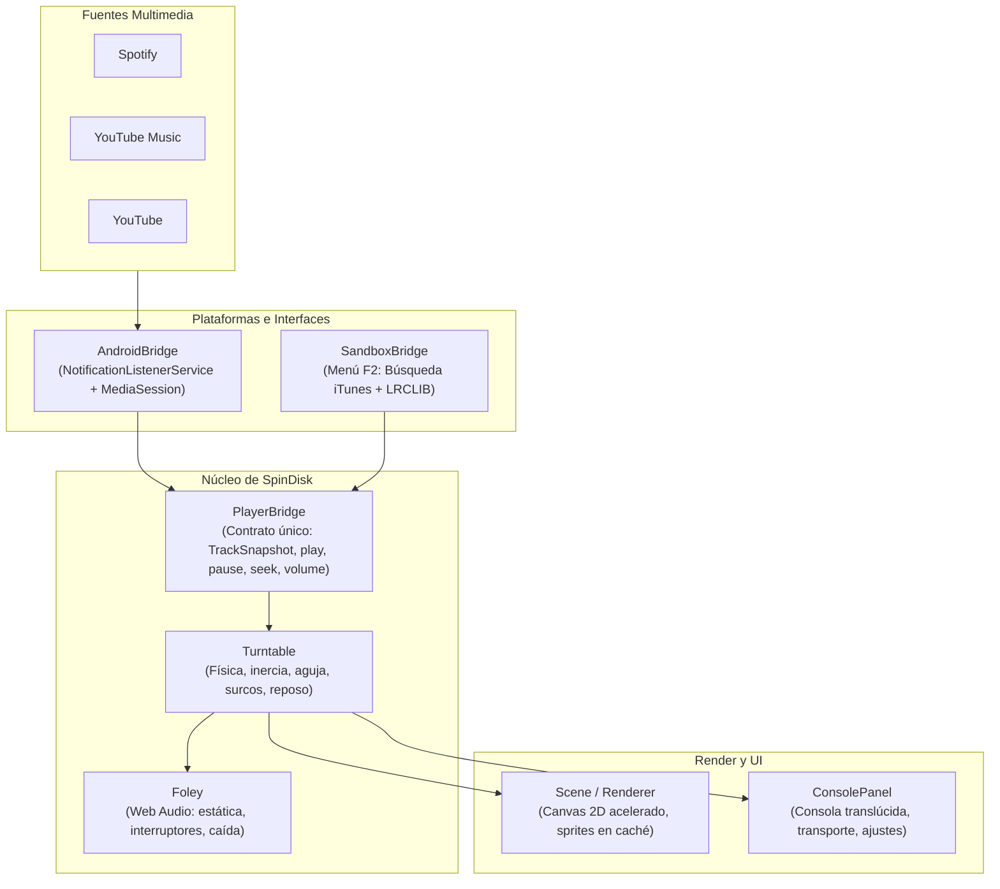

# SpinDisk · Tocadiscos de escritorio

> **Tocadiscos analógico interactivo para tablets Android en orientación horizontal.**  
> No es un reproductor más: SpinDisk se conecta a la sesión multimedia de lo que ya está sonando en **Spotify**, **YouTube Music** o **YouTube**, convirtiéndolo en una experiencia física táctil: vinilo que gira, aguja fonocaptora sobre el surco, carátula de cartón volteable con letras sincronizadas y reloj de reposo de bajísimo consumo.

---

## ✨ Características destacadas

* 🎛️ **Física de tocadiscos real:**
  - Inercia mecánica precisa al arrancar y frenar (33⅓ y 45 RPM).
  - Freno táctil con el dedo: apoya la mano sobre el vinilo para pausar la reproducción y suéltala para reanudar suavemente.
  - Arrastre manual del brazo y la aguja para adelantar o retroceder en pistas con soporte (*Spotify Premium* / *YouTube*).
  - Modo protegido (*Spotify Free*): la aguja vibra hápticamente y rebota elásticamente a su posición sin desincronizarse; llevarla al centro salta de canción.

* 🎨 **Texturas de vinilo y fondos de mesa:**
  - **7 texturas de vinilo:** Marmoleado procedural camaleónico, Negro clásico 180 g, Crema vintage, Cristal translúcido, Humo ámbar, Terracota suave y Verde salvia veteado.
  - **5 fondos de escritorio:** Portada adaptativa, Madera de nogal cálido con vetas orgánicas, Arena y lino con sutil trama textil, Pizarra grafito nocturna y Verde salvia relajante.
  - Motor cromático *«Tierra y Pastel»* que extrae colores armónicos de la carátula en tiempo real.

* 🔊 **Sonido Foley 100% sintetizado en tiempo real:**
  - Generado puramente con Web Audio API (cero archivos MP3 o WAV descargados).
  - Chisporroteo de polvo y surco en bucle normalizado que se apaga al levantar la aguja.
  - Golpe y caída sutil de la púa al posarse en el disco y chasquido mecánico de encendido/apagado.
  - Control de volumen sincronizado directamente con el volumen multimedia del sistema Android.

* 📖 **Funda interactiva y letras sincronizadas (*Liner Notes*):**
  - Toca la carátula para voltear la funda 180° en 3D con visualización del espesor del cartón.
  - Reverso con letras sincronizadas verso a verso mediante [LRCLIB](https://lrclib.net/) con subrayado dinámico en color terracota.
  - Ficha técnica automática cuando una canción es instrumental o no dispone de letra en el archivo.

* 🕰️ **Modo Reposo y Reloj de Mesa:**
  - Tras 60 segundos de pausa, la aguja aparca, el disco se guarda en la funda y aparece un elegante fajín de papel con la hora, fecha y frases poéticas aleatorias.
  - Consumo ultra bajo: la escena se detiene y sólo realiza **un repintado por minuto**.
  - Opción de *«Reloj de día»*: muestra la hora en una etiqueta visible sobre la mesa mientras la música suena.

* 📱 **Consola de control ergonómica:**
  - Se abre deslizando desde el borde inferior, tocando la esquina superior izquierda o tocando la mesa vacía.
  - Auto-ocultación tras 3 segundos de inactividad o cierre instantáneo deslizando hacia abajo (*swipe down*).
  - Acceso directo a la app en reproducción con soporte para ventana flotante / multiventana.

---

## 🏗️ Arquitectura del sistema

SpinDisk separa por completo la lógica de reproducción del motor gráfico y la física:



---

## 🚀 Desarrollo local

No necesitas Android Studio, JDK ni emuladores para desarrollar o probar el 95% de la aplicación. Solo necesitas **Node.js 20+**.

```bash
# Instalar dependencias de desarrollo (TypeScript y @napi-rs/canvas)
npm install

# Iniciar servidor de desarrollo en http://127.0.0.1:5173
npm run dev
```

> **Consejo:** Al abrir el proyecto en el navegador, presiona **`F2`** para abrir el menú secreto **Sandbox**: permite buscar cualquier canción real en iTunes, cargar su carátula y letra, probar cuentas *Free* vs *Premium* y simular cambios de pista.

---

## 📋 Comandos y bancos de pruebas

El proyecto cuenta con un conjunto exhaustivo de bancos de pruebas automatizados que no requieren navegador:

| Comando | Función | Cobertura / Estado |
| :--- | :--- | :--- |
| `npm run typecheck` | Comprobación estricta de tipos con TypeScript | 21 archivos sin errores |
| `npm run build` | Compila módulos TypeScript a `dist/` | 21 módulos + 2 estáticos (~1.5 s) |
| `npm run ui` | Pruebas de consola, transporte, gestos y DOM | **104/104** comprobaciones ✅ |
| `npm run sim` | Simulación matemática de física, inercia y aguja | **62/62** comprobaciones ✅ |
| `npm run audio` | Inspección de nodos WebAudio y niveles Foley | **43/43** comprobaciones ✅ |
| `npm run native:check` | Validación estática del contrato TS ↔ Kotlin | **38/38** comprobaciones ✅ |
| `npm run bridge` | Prueba del puente nativo con doble de Android | **31/31** comprobaciones ✅ |
| `npm run perf` | Perfilado de memoria (fuga de heap) y frametime | 0 MB fuga en 800 frames |
| `npm run native` | Compila y sincroniza assets con el proyecto Android | 220 KB en `assets/www` |
| `npm run preview -- <caso>` | Genera capturas PNG de la escena en `docs/captures/` | Render Skia nativo |

### Escenarios de captura visual disponibles:
```bash
node scripts/preview.mjs desk          # Mesa vacía
node scripts/preview.mjs track         # Canción sonando con vinilo fuera
node scripts/preview.mjs flip          # Carátula volteada con letras
node scripts/preview.mjs terracotta    # Textura terracota
node scripts/preview.mjs sage          # Textura verde salvia
node scripts/preview.mjs smoke         # Textura humo ámbar
node scripts/preview.mjs clock         # Modo reloj de reposo
```

---

## 📦 Compilación y descarga del APK

El APK de Android se compila automáticamente en la nube a través de GitHub Actions (`.github/workflows/build-apk.yml`) en cada *push* a `main`.

- **Cero dependencias pesadas:** No utiliza Capacitor ni frameworks inflados; la app consta de una única `Activity` con un `WebView` de alto rendimiento y un `NotificationListenerService` nativo en Kotlin.
- **Tamaño ultra-reducido:** El instalador pesa solo **~0.83 MB** (frente a los 15-50 MB habituales).
- **Instalación:**
  1. Ve a la pestaña **Actions** en GitHub y descarga el artefacto **`spindisk-apk`**.
  2. Transfiere el archivo `spindisk.apk` a tu tablet e instálalo.
  3. Al abrir la app por primera vez, concede el permiso de **Acceso a notificaciones** para que pueda leer la información de la canción en reproducción.
  4. Para detalles sobre permisos o advertencias de Play Protect, consulta la guía en [`docs/apk.md`](docs/apk.md).

---

## 📊 Presupuesto de recursos y eficiencia

| Métrica | Presupuesto objetivo | Medición real |
| :--- | :--- | :--- |
| **Tamaño del APK** | < 15 MB | **0.83 MB** |
| **Assets web instalados** | < 1 MB | **220 KB** |
| **Frecuencia en reposo** | 1 frame / minuto | **1 frame / minuto** (modo `settled`) |
| **Tiempo de render girando** | < 16.6 ms (60 FPS) | **~1.2 ms** (CPU pesimista) |
| **Fuga de memoria** | 0 MB | **0 MB** de retención tras 800 frames |

---

## 📄 Licencia

Proyecto privado desarrollado para uso personal en tablets y dispositivos de escritorio dedicados.
